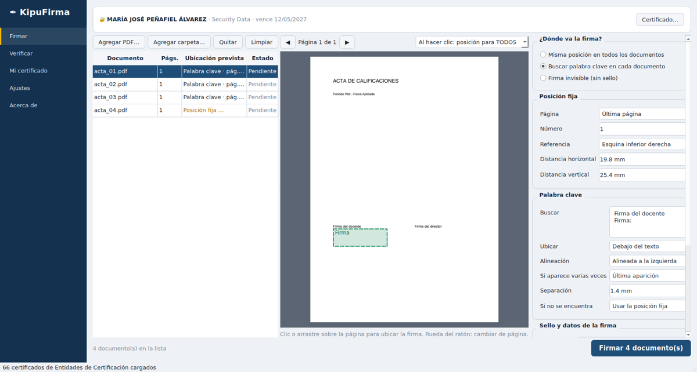
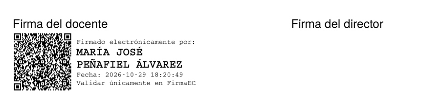

<p align="center">
  
</p>

<h1 align="center">KipuFirma</h1>

<p align="center">
  Firma electrónica de documentos PDF para Ecuador — por lotes, con ubicación por palabra clave,<br>
  certificado <code>.p12</code> recordado y firmas compatibles con el validador oficial FirmaEC.
</p>

<p align="center">
  <a href="https://github.com/jorgeosmani/kipufirma/actions/workflows/ci.yml"></a>
  
  
  
</p>

> KipuFirma **no es un producto oficial** del Gobierno del Ecuador. Se basa en el
> análisis de [FirmaEC](https://www.firmadigital.gob.ec) (MINTEL, software libre).
> La validez legal de la firma depende de su certificado: emitido por una entidad
> acreditada, vigente, no revocado y bajo su control exclusivo.



## ¿Qué ofrece?

| | FirmaEC 5.3.0 | **KipuFirma** |
|---|---|---|
| Recordar el `.p12` y pedir solo la contraseña | Recuerda la ruta | ✅ Ruta + huella SHA-256; avisa si el archivo cambió |
| Firmar muchos documentos | ✅ Misma posición para todos | ✅ Misma posición **o** una por documento |
| Ubicar la firma por **palabra clave** | ❌ | ✅ Sin importar tildes/mayúsculas, alternativas, primera/última/todas |
| Tamaños de hoja | Solo A4 | ✅ Cualquiera, y páginas giradas |
| Errores en un lote | Ventana por cada error | ✅ El lote continúa; informe CSV al final |
| Verificar cada firma recién hecha | ❌ | ✅ Automático |
| Vista previa de dónde quedará cada firma | Solo el primer documento | ✅ Cada documento |
| Formato | PAdES `adbe.pkcs7.detached`, SHA-512 | ✅ Igual (por defecto) o PAdES ETSI |
| Entidades reconocidas | 16 (66 certificados) | ✅ Las mismas, verificadas criptográficamente |
| Línea de comandos | ❌ | ✅ `kipufirma-cli` |

<p align="center"></p>

## Instalación rápida (Windows 11)

1. Descargue **`KipuFirma-<versión>-instalador.exe`** de [Releases](https://github.com/jorgeosmani/kipufirma/releases).
2. Instale marcando **«Crear un acceso directo en el escritorio»** (y, si quiere, «Firmar con KipuFirma» en el clic derecho).
3. Abra KipuFirma → **Mi certificado** → seleccione su `.p12`. ¡Listo!

Desde el código fuente:

```powershell
git clone https://github.com/jorgeosmani/kipufirma.git
cd kipufirma
powershell -ExecutionPolicy Bypass -File scripts\instalar_desarrollo.ps1   # crea .venv, prueba y crea el acceso directo
```

Más detalles: [docs/COMPILACION_WINDOWS.md](docs/COMPILACION_WINDOWS.md).

## Uso en 30 segundos

1. Arrastre PDF o carpetas a **Firmar**.
2. Elija **Misma posición** (clic en la vista previa) o **Palabra clave** (p. ej. `Firma del docente`).
3. **Firmar N documentos** → escriba su contraseña → listo. Los firmados quedan en `firmados\`.

Manual completo: [docs/MANUAL_jorgeosmani.md](docs/MANUAL_jorgeosmani.md).

## Seguridad

* La contraseña **nunca se guarda** y se borra de memoria al terminar.
* Bloqueo progresivo tras contraseñas incorrectas.
* Verificación de vigencia, uso de clave, **cadena hasta las entidades ecuatorianas** y **revocación OCSP/CRL** (firma de la respuesta verificada).
* Detección de PDF con JavaScript, acciones `/Launch`, adjuntos o XFA.
* El original nunca se modifica; escritura atómica; firma verificada antes de guardar.
* Registros sin datos sensibles (cédulas enmascaradas).

Modelo de amenazas: [docs/SEGURIDAD.md](docs/SEGURIDAD.md) · Reportes: [SECURITY.md](SECURITY.md).

## Antes de usarlo en documentos reales

Ejecute las [pruebas de aceptación](docs/PRUEBAS_ACEPTACION.md) con su
certificado y confirme en el **validador oficial FirmaEC** que sus documentos
aparecen válidos. Marco normativo: [docs/MARCO_LEGAL.md](docs/MARCO_LEGAL.md).

## Documentación

| Documento | Contenido |
|---|---|
| [ANALISIS_FIRMAEC.md](docs/ANALISIS_FIRMAEC.md) | Estudio de FirmaEC, buenas prácticas, carencias y decisiones |
| [ARQUITECTURA.md](docs/ARQUITECTURA.md) | Capas, flujo de firma, coordenadas |
| [SEGURIDAD.md](docs/SEGURIDAD.md) | Modelo de amenazas y controles |
| [MARCO_LEGAL.md](docs/MARCO_LEGAL.md) | Resumen normativo (Ecuador) |
| [MANUAL_jorgeosmani.md](docs/MANUAL_jorgeosmani.md) | Guía de uso |
| [COMPILACION_WINDOWS.md](docs/COMPILACION_WINDOWS.md) | Instalación, compilación, CLI |
| [PRUEBAS_ACEPTACION.md](docs/PRUEBAS_ACEPTACION.md) | Protocolo con certificado real |
| [PUBLICAR_EN_GITHUB.md](docs/PUBLICAR_EN_GITHUB.md) | Cómo subir y publicar versiones |

## Desarrollo

```bash
pip install -r requirements-dev.txt && pip install -e . --no-deps
QT_QPA_PLATFORM=offscreen pytest -q      # 64 pruebas: PKI simulada, sin certificados reales
ruff check src tests
```

Estructura:

```
src/kipufirma/core/      núcleo (sin Qt): certificados, PDF, ubicación, firma, lotes
src/kipufirma/gui/       interfaz PySide6
src/kipufirma/resources/ anclas de confianza ECEP e íconos
packaging/               PyInstaller + Inno Setup
scripts/                 PowerShell (instalar, compilar, acceso directo) y validador
tools/                   extracción de anclas desde FirmaEC, íconos
tests/                   pruebas automáticas
```

Contribuciones: [CONTRIBUTING.md](CONTRIBUTING.md).

## Autor

**Jorge Osmani Ordonez Ordonez**

- osmany_o_o@hotmail.com
- osmani.ordonez99@gmail.com

## Licencia

[AGPL-3.0-or-later](LICENSE). Atribuciones a FirmaEC y componentes de terceros en [NOTICE.md](NOTICE.md).
