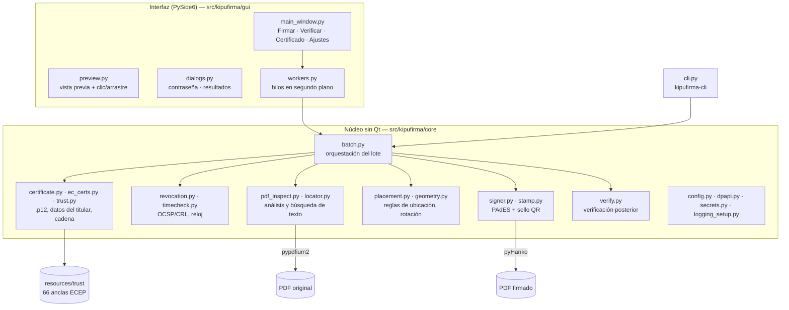
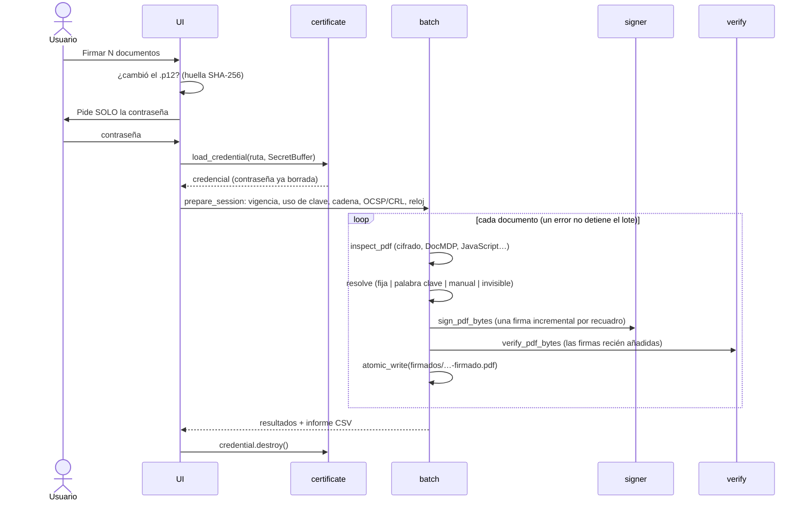

# Arquitectura

## Capas

## Flujo de firma de un lote

## Sistemas de coordenadas
* **Espacio de usuario PDF**: el que usan la firma y PDFium para el texto.
* **Espacio visual**: la página como se ve (con `/Rotate` aplicado), origen
  abajo-izquierda, en puntos. Las reglas («esquina inferior derecha»,
  «debajo de la palabra») se evalúan aquí y se convierten con
  `PageGeom.to_user/to_visual`. El sello se contrarrota (matriz `cm`) para
  leerse derecho en páginas giradas.

## Decisiones clave
* **Núcleo sin Qt** → testeable, reutilizable por la CLI.
* **`KeySigner`** firma con el objeto de clave de `cryptography` sin
  serializarla (pyHanko `SimpleSigner` la exporta a DER en cada firma).
* **Una firma por recuadro**: el estándar no permite una firma con varios
  widgets de forma interoperable; «todas las apariciones» genera N firmas.
* **Verificación posterior obligatoria** y **escritura atómica**.
* **Configuración JSON** versionada (`schema`), tolerante a campos
  desconocidos, con respaldo si está corrupta.
